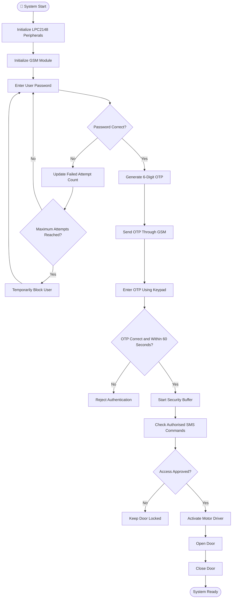

# 🔐 SecureEntry – GSM-Based Two-Step Time-Limited Door Access System

> **🔧 Embedded C | LPC2148 (ARM7) | 📡 GSM | 🔑 OTP | 🖥️ LCD | 🔢 4×4 Keypad | ⏰ RTC | 💾 SPI EEPROM | 🚪 Door Control**

A microcontroller-based security and access-control system designed to provide two-step authentication using password verification and GSM-based One-Time Password (OTP). The system validates user credentials, sends a time-limited OTP to the registered mobile number, and controls door access after successful authentication.

---

## 📌 Project at a Glance

| Item | Details |
|---|---|
| 🏷️ Project Domain | Embedded Systems / Security and Access Control |
| 🧠 Controller | LPC2148 (ARM7) |
| 💻 Programming Language | Embedded C |
| 🔐 Authentication | Password + GSM-Based OTP |
| 📡 Communication | GSM, UART and SPI |
| 🖥️ User Interface | 16×2 LCD and 4×4 Matrix Keypad |
| ⏰ Time Source | RTC Module |
| 💾 External Storage | 25LC512 SPI EEPROM |
| 🚪 Door Control | Motor Driver and DC Motor |
| 🛠️ Development Tools | Keil µVision 4 and Flash Magic |

## 📖 Overview

The **SecureEntry – GSM-Based Two-Step Time-Limited Door Access System** is an embedded security project developed using the LPC2148 ARM7 microcontroller.

The system implements two-step authentication to improve access security. Initially, the user enters a registered password through a 4×4 matrix keypad. After successful password verification, the system generates a six-digit OTP and sends it to the registered mobile number through the GSM module.

The OTP is valid for 60 seconds. The user must enter the correct OTP within the validity period to proceed with authentication.

The system also provides failed-password attempt monitoring, temporary user blocking, SMS-based BLOCK and UNBLOCK commands, RTC-based time management, EEPROM data storage, and automatic door operation.

## 🎯 Objectives

- 🔐 Implement two-step authentication using password and OTP verification.
- 📩 Send OTP messages to registered mobile numbers using GSM.
- ⏰ Implement a 60-second OTP validity period.
- 🚪 Control door access through an LPC2148 microcontroller.
- 🛡️ Prevent unauthorised access through failed-password attempt monitoring.
- 📲 Support SMS-based user blocking and unblocking.
- 💾 Store user and security-related information in external EEPROM.
- ⏱️ Use RTC for time-related security operations.
- 🔧 Develop modular Embedded C firmware for peripheral interfacing.

## ✨ System Features

### 🔐 Two-Step Authentication

The system uses two authentication stages:

1. Password verification through the keypad.
2. OTP verification through the registered mobile number.

Access is permitted only after successful authentication and the configured security checks.

### 📩 GSM-Based OTP Verification

- Generates a six-digit OTP.
- Sends the OTP through the GSM module.
- Sends the OTP to the registered mobile number.
- Validates the entered OTP.
- Rejects expired OTPs after 60 seconds.

### ⏰ Time-Limited OTP

The OTP verification process uses a configured validity period of 60 seconds.

If the user enters an incorrect OTP or the validity period expires, authentication is rejected.

### 🛡️ Failed Password Attempt Protection

- Monitors incorrect password attempts.
- Maintains the failed-attempt counter.
- Blocks the user after three incorrect password attempts.
- Applies a configured temporary blocking period.
- Maintains security-related information using EEPROM.

### 📲 SMS-Based User Management

The system supports SMS commands from an authorised registered mobile number.

| SMS Command | Function |
|---|---|
| `BLOCK <USER_ID>` | Blocks the specified user |
| `UNBLOCK <USER_ID>` | Removes the block status of the specified user |

The system validates the registered sender's mobile number and corresponding user ID before processing commands.

### 🚪 Automatic Door Control

- Controls the door using a motor-driver interface.
- Opens the door after successful authentication and access approval.
- Returns the door to its secure state after the configured operation.

### 💾 EEPROM Data Storage

Uses external SPI EEPROM to store persistent user and security-related information.

### 🖥️ LCD Information Display

The 16×2 LCD displays authentication prompts, OTP status, GSM status, security messages, and door-operation information.

### 🔢 Keypad Input

The 4×4 matrix keypad provides an interface for entering passwords, OTPs, and other user inputs.

---

## 🧰 Hardware Components

| Component | Purpose |
|---|---|
| 🧠 LPC2148 Microcontroller | Main controller for authentication and peripheral management |
| 📡 GSM Module | Sends OTP messages and receives SMS commands |
| 🖥️ 16×2 LCD | Displays system information and authentication status |
| 🔢 4×4 Matrix Keypad | Accepts password and OTP input |
| ⏰ RTC Module | Provides date and time information |
| 💾 25LC512 SPI EEPROM | Stores persistent security-related information |
| ⚙️ Motor Driver | Interfaces the controller with the door motor |
| 🚪 DC Motor | Performs door opening and closing operations |
| 🔌 Power Supply | Provides power to the embedded system |

### 🧠 1. LPC2148 Microcontroller

The LPC2148 is an ARM7-based 32-bit microcontroller used as the main processing unit.

It handles:
- User authentication.
- OTP verification.
- GSM communication.
- LCD and keypad interfacing.
- RTC operations.
- EEPROM communication.
- Door motor control.

### 📡 2. GSM Module

The GSM module provides SMS-based communication between the embedded system and the registered mobile phone.

It is used for:
- Sending OTP messages.
- Receiving BLOCK and UNBLOCK commands.
- Checking GSM network availability.
- Communicating with the controller through UART.

### 🖥️ 3. 16×2 LCD

The LCD provides visual feedback to the user.

It displays:
- Welcome messages.
- Password entry status.
- OTP verification status.
- GSM network status.
- User blocking information.
- Door operation status.

### 🔢 4. 4×4 Matrix Keypad

The keypad contains four rows and four columns, providing 16 key positions.

It is used to enter:
- User credentials.
- Password.
- OTP.
- Other application inputs.

### ⏰ 5. Real-Time Clock (RTC)

The RTC maintains date and time information.

It supports time-related operations such as OTP validity and security timing.

### 💾 6. SPI EEPROM (25LC512)

The external EEPROM provides non-volatile data storage.

It is used to maintain persistent user and security-related information.

### 🚪 7. Door Control Mechanism

The motor driver interfaces the LPC2148 with the DC motor.

It controls the door mechanism after the authentication process is completed successfully.

---

## 📍 Pin Configuration

The actual pin configuration depends on the board connections and peripheral driver implementation.

| Peripheral | Interface | Purpose |
|---|---|---|
| LCD | GPIO | Display control and data |
| Keypad | GPIO | Row and column scanning |
| GSM Module | UART | SMS communication |
| SPI EEPROM | SPI | Read and write operations |
| RTC | Configured RTC interface | Date and time management |
| Door Motor | GPIO / Motor Driver | Door control |
| External Interrupt | EINT | Interrupt-driven event handling |
| Switches | GPIO | User and system input |

*Refer to the actual circuit and source-code pin definitions before making hardware connections.*

## 🔐 Authentication Workflow

### Stage 1: Password Authentication

1. The user enters the registered password using the keypad.
2. The system validates the entered password.
3. If the password is incorrect, the failed-attempt counter is updated.
4. After three incorrect attempts, the user is temporarily blocked.

### Stage 2: OTP Authentication

1. After successful password verification, the system generates a six-digit OTP.
2. The GSM module sends the OTP to the registered mobile number.
3. The user enters the received OTP through the keypad.
4. The system validates the entered OTP.
5. OTP verification must be completed within 60 seconds.

### Stage 3: Security Buffer

After successful OTP verification, the system provides a configured 60-second security buffer.

During this period:
- The system checks incoming SMS messages.
- It verifies the registered sender's mobile number.
- It validates the corresponding user ID.
- It processes authorised BLOCK and UNBLOCK commands.

### Stage 4: Door Operation

After successful authentication and access approval:

1. The controller activates the door mechanism.
2. The motor driver controls the DC motor.
3. The door operates for the configured duration.
4. The system returns the door to its secure state.

---

## 🔄 System Workflow


## 🔄 System Workflow – SecureEntry




## 🧭 Program Execution Flow

1. 🚀 **Startup:** Initialize the LPC2148 microcontroller and required peripherals.
2. 🖥️ **LCD Initialization:** Initialize the LCD display.
3. 🔢 **Keypad Initialization:** Configure keypad scanning.
4. 📡 **GSM Initialization:** Configure UART communication and check GSM network readiness.
5. ⏰ **RTC Initialization:** Initialize the real-time clock.
6. 💾 **EEPROM Initialization:** Configure SPI communication and external EEPROM.
7. 🔐 **User Authentication:** Accept and validate the user's password.
8. 🔢 **OTP Generation:** Generate the six-digit OTP.
9. 📩 **OTP Transmission:** Send OTP through the GSM module.
10. ⏱️ **OTP Verification:** Validate OTP and its validity period.
11. 📲 **SMS Monitoring:** Check authorised BLOCK and UNBLOCK commands during the configured security buffer.
12. 🚪 **Door Control:** Operate the door after successful access approval.
13. 🔄 **System Monitoring:** Continue the application workflow.

## 🧱 System Architecture


                 USER
                  |
                  v
          4x4 MATRIX KEYPAD
                  |
                  v
          +----------------+
          |                |
          |    LPC2148     |
          |    ARM7 MCU    |
          |                |
          +----------------+
             |    |    |
      +------+    |    +--------+
      |           |             |
      v           v             v
     LCD         GSM          RTC
                  |
                  v
            REGISTERED PHONE
                  |
                  v
             SMS / OTP

             LPC2148
                |
                v
          SPI EEPROM
                |
                v
          USER DATA STORAGE

             LPC2148
                |
                v
           MOTOR DRIVER
                |
                v
             DC MOTOR
                |
                v
           DOOR CONTROL

## 🛠️ Software and Development Tools

- 💻 **Embedded C:** Used to develop the microcontroller firmware.
- 🧰 **Keil µVision 4:** Used for coding, compilation, and debugging.
- 🔌 **Flash Magic:** Used for programming supported NXP microcontrollers.
- 📡 **UART:** Used for GSM communication.
- 🔗 **SPI:** Used for external EEPROM communication.

## 🗂️ Project Structure and File Organization

```text
SecureEntry/
│
├── README.md
│
├── main.c
├── main_dly.c
│
├── user.c
├── user.h
│
├── otp.c
├── otp.h
│
├── gsm.c
├── gsm.h
│
├── door.c
├── door.h
├── door_cgram.c
├── door_cgram.h
│
├── lcd.c
├── lcd.h
├── lcd_defines.h
│
├── Keypad.c
├── kpm.h
├── kpm_defines.h
│
├── uart.c
├── uart.h
├── uart_defines.h
│
├── rtc.c
├── rtc.h
│
├── spi.c
├── spi.h
├── spi_defines.h
│
├── spi_eeprom.c
├── spi_eeprom.h
│
├── eint.c
├── eint.h
│
├── switch.c
├── switch.h
│
├── delay.h
├── defines.h
├── types.h
│
└── Startup.s
```

### 📄 Important Source Files

| File | Description |
|---|---|
| `main.c` | Main application and program execution |
| `user.c` | User authentication and security handling |
| `otp.c` | OTP generation and verification |
| `gsm.c` | GSM communication and SMS processing |
| `door.c` | Door control operations |
| `rtc.c` | RTC operations |
| `spi_eeprom.c` | External EEPROM operations |
| `uart.c` | UART communication |
| `lcd.c` | LCD driver functions |
| `Keypad.c` | Keypad scanning functions |
| `eint.c` | External interrupt configuration |
| `Startup.s` | ARM startup configuration |

## 🧪 Testing and Verification

- [ ] LCD displays the welcome message.
- [ ] Keypad accepts user input.
- [ ] GSM module initializes successfully.
- [ ] GSM network registration is successful.
- [ ] Correct password proceeds to OTP generation.
- [ ] OTP is delivered to the registered mobile number.
- [ ] Correct OTP is accepted within 60 seconds.
- [ ] Incorrect OTP is rejected.
- [ ] Expired OTP is rejected.
- [ ] Failed password attempts are counted correctly.
- [ ] User blocking works after the configured maximum attempts.
- [ ] Unregistered SMS senders are rejected.
- [ ] Valid BLOCK command is processed.
- [ ] Valid UNBLOCK command is processed.
- [ ] Door opens only after successful authentication.

## 🚀 Possible Future Enhancements

📱 Mobile application integration.

🔒 Biometric authentication.

🌐 IoT-based remote access monitoring.

📊 Security event logging.

📩 Real-time security notifications.

🔋 Battery backup and power-failure alerts.

🛡️ Cryptographically secure OTP generation.

🚪 Door-position sensor integration.

## 👩‍💻 Project Information

- **📌 Project Title:** SecureEntry – GSM-Based Two-Step Time-Limited Door Access System
- **🧠 Controller:** LPC2148 ARM7
- **💻 Programming Language:** Embedded C
- **📡 Communication:** GSM, UART and SPI
- **🔧 Domain:** Embedded Systems and Security
- **🛠️ IDE:** Keil µVision 4

## 📝 Conclusion

The SecureEntry GSM-Based Two-Step Time-Limited Door Access System demonstrates the integration of embedded peripherals and communication technologies to develop a password and OTP-based security solution.

The project combines ARM7 microcontroller programming, GSM communication, OTP verification, RTC, EEPROM, keypad interfacing, LCD display, and motor control in a modular Embedded C application.

It provides practical learning in embedded system development, hardware interfacing, communication protocols, security logic, and real-time application design.

---

<div align="center">

### 🔐 SecureEntry – Smart Access, Enhanced Security!

**LPC2148 ARM7 • Embedded C • GSM • OTP • UART • SPI • RTC • EEPROM**

⭐ If you find this project useful, don't forget to give this repository a star!

</div>
